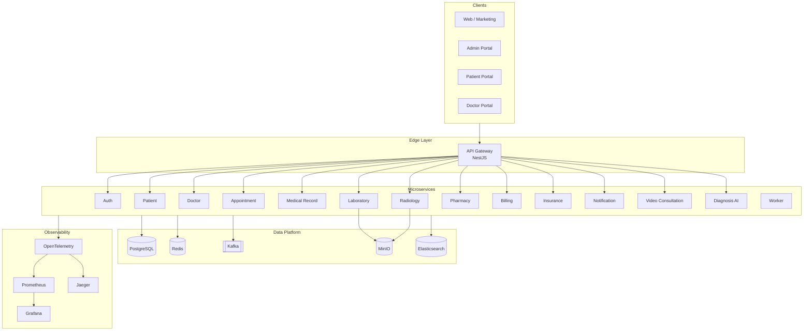

# MedSphere

Enterprise Hospital Information System (HIS), Electronic Medical Record (EMR), and Electronic Health Record (EHR) platform for hospitals, clinics, laboratories, pharmacies, and insurance providers.

**Version 1.0.0** — Production ready (Phase 8 complete)

## Quickstart

```bash
# Prerequisites: Node.js 20+, pnpm 9+, Docker
pnpm install
pnpm docker:up          # Start PostgreSQL, Redis, Kafka, monitoring stack
pnpm db:migrate         # Apply database migrations
pnpm dev                # Start all apps and services

# Production stack (local)
docker compose -f infrastructure/docker/docker-compose.prod.yml up -d

# Health check
node scripts/ops/health-check-all.mjs
node scripts/ops/smoke-test.mjs
```

## Architecture



## Repository Structure

| Layer | Path | Purpose |
|-------|------|---------|
| Applications | `apps/` | Next.js portals and NestJS API gateway |
| Microservices | `services/` | Domain-bounded NestJS / FastAPI services |
| Shared packages | `packages/` | Database, UI, auth SDK, monitoring, shared utils |
| Infrastructure | `infrastructure/` | Docker, Kubernetes, Helm, Terraform |
| Tests | `tests/` | E2E, load, performance, contract tests |
| Documentation | `docs/` | Architecture, security, deployment guides |

## Production Deployment

| Environment | Method | Config |
|-------------|--------|--------|
| Development | Docker Compose | `infrastructure/docker/docker-compose.yml` |
| Staging | Helm | `infrastructure/helm/charts/medsphere/values.yaml` |
| Production | Helm + Kustomize | `infrastructure/helm/values/values.prod.yaml` |

```bash
# Deploy to production
helm upgrade --install medsphere infrastructure/helm/charts/medsphere \
  -f infrastructure/helm/values/values.prod.yaml \
  -n medsphere --create-namespace

# Or Kustomize overlay
kubectl apply -k infrastructure/kubernetes/overlays/prod
```

## Key Services

| Service | Port | Health |
|---------|------|--------|
| API Gateway | 4000 | `/health/live` |
| Auth | 3001 | `/api/v1/health/live` |
| Patient | 3010 | `/api/v1/health/live` |
| Diagnosis AI | 4200 | `/health` |

Full service map: [docs/architecture/README.md](docs/architecture/README.md)

## Security & Compliance

- HIPAA technical safeguards — [docs/security/hipaa-control-matrix.md](docs/security/hipaa-control-matrix.md)
- OWASP Top 10 mitigations — [docs/security/owasp-top10.md](docs/security/owasp-top10.md)
- Security headers, CSRF guards, input sanitization built into gateway and auth SDK
- Secret scanning (Gitleaks) and container scanning (Trivy) in CI

## Testing

```bash
pnpm test:cov                                          # Unit tests (90% threshold target)
node scripts/ops/run-contract-tests.mjs                # Contract tests
npx playwright test --config tests/e2e/playwright.config.ts  # E2E
k6 run tests/load/k6/gateway-proxy.js                # Load test
k6 run tests/performance/k6/soak-test.js             # Soak test
```

## Documentation

- [Developer Guide](docs/guides/developer-guide.md)
- [Admin Guide](docs/guides/admin-guide.md)
- [User Guide](docs/guides/user-guide.md)
- [Deployment Guide](docs/deployment/README.md)
- [Production Readiness Checklist](docs/architecture/PRODUCTION_READINESS.md)

## Tech Stack

- **Frontend:** Next.js, React, TypeScript, TailwindCSS, ShadCN UI
- **Backend:** NestJS, TypeScript; Diagnosis AI: FastAPI, Python
- **Data:** PostgreSQL (Prisma), Redis, Kafka, MinIO, Elasticsearch
- **Ops:** Docker, Kubernetes, Helm, Prometheus, Grafana, OpenTelemetry

## License

Proprietary — All rights reserved.
