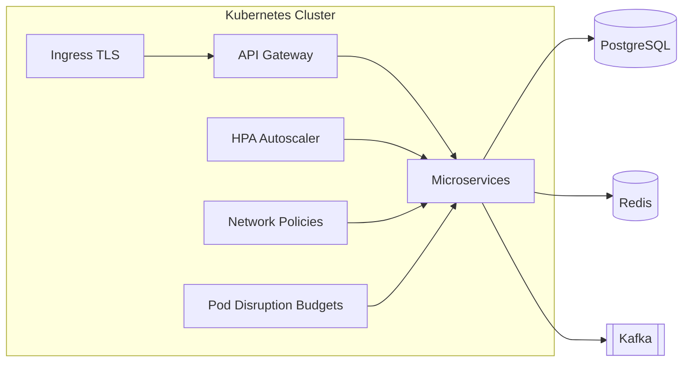

# MedSphere Platform Architecture

## Overview

MedSphere is a distributed hospital information platform built as a Turborepo monorepo. Domain boundaries follow DDD bounded contexts mapped 1:1 to NestJS (or FastAPI for AI) microservices behind an API gateway.

**Production status:** Phase 8 complete — see [PRODUCTION_READINESS.md](PRODUCTION_READINESS.md)

## Style

- Clean Architecture (domain → application → infrastructure → presentation)
- CQRS for write/read separation in clinical and billing domains
- Event-driven integration via Kafka
- Repository + Specification patterns for persistence
- Dependency injection throughout NestJS services

## Request Flow

```
Client Portals (Next.js)
        │
        ▼
   API Gateway (auth, rate limit, routing, security headers, CSRF)
        │
        ├── REST / GraphQL / WebSocket
        ▼
 Domain Microservices (NestJS)
        │
        ├── PostgreSQL (system of record via Prisma)
        ├── MongoDB (unstructured clinical notes / docs metadata)
        ├── Redis (sessions, cache, rate limits)
        ├── Elasticsearch (clinical search)
        ├── MinIO (PHI documents, imaging objects)
        └── Kafka (domain events, async workflows)
```

## Production Topology



## Bounded Contexts

| Context | Service | Primary Stores |
|---------|---------|----------------|
| Identity & Access | auth | PostgreSQL, Redis |
| Patient Administration | patient | PostgreSQL |
| Clinical Staff | doctor | PostgreSQL |
| Scheduling | appointment, queue | PostgreSQL, Redis |
| Clinical Documentation | medical-record | PostgreSQL, MongoDB, MinIO |
| Pharmacy | pharmacy, prescription | PostgreSQL |
| Laboratory | laboratory | PostgreSQL, MinIO |
| Radiology / Imaging | radiology, imaging | PostgreSQL, MinIO, DICOM |
| Revenue Cycle | billing, payment, insurance | PostgreSQL |
| AI / CDS | diagnosis-ai | PostgreSQL, MinIO, PyTorch models |
| Engagement | notification, video-consultation | PostgreSQL, Redis, Kafka |
| Platform | audit, search, analytics, worker | Mixed |

## Security Boundaries

- JWT + MFA at gateway; service-to-service mTLS in cluster
- RBAC + ABAC for clinical resource access
- Security headers (HSTS, CSP, Permissions-Policy) at gateway
- CSRF double-submit guard for cookie-based portal sessions
- Input sanitization via `@medsphere/shared`
- PHI encryption at rest (DB TDE / field-level where required) and TLS in transit
- Immutable audit trail via audit service
- Secrets via Kubernetes secrets / external secret manager (never in repo)

## Observability

- OpenTelemetry bootstrap: `packages/monitoring-sdk/src/nestjs-instrumentation.ts`
- Jaeger (traces), Prometheus/Grafana (metrics), Loki (logs)
- SLO dashboard: `infrastructure/docker/monitoring/grafana/dashboards/slo-dashboard.json`
- Every service exposes `/health/live` and `/health/ready`
- Alert runbooks: `docs/deployment/runbooks/`

## Feature Flags

- Evaluator: `packages/shared/src/feature-flags/evaluator.ts`
- Admin API: auth service `/api/v1/feature-flags`
- Supports percentage rollout and organization targeting

## Phase Documentation

| Phase | Document |
|-------|----------|
| 1 | [phase-1.md](phase-1.md) |
| 8 | [phase-8.md](phase-8.md) |
| Production | [PRODUCTION_READINESS.md](PRODUCTION_READINESS.md) |

## Related Documents

- [Database](../database/README.md)
- [API](../api/README.md)
- [Security](../security/README.md)
- [Deployment](../deployment/README.md)
- [HIPAA Controls](../security/hipaa-control-matrix.md)
- [OWASP Mitigations](../security/owasp-top10.md)
